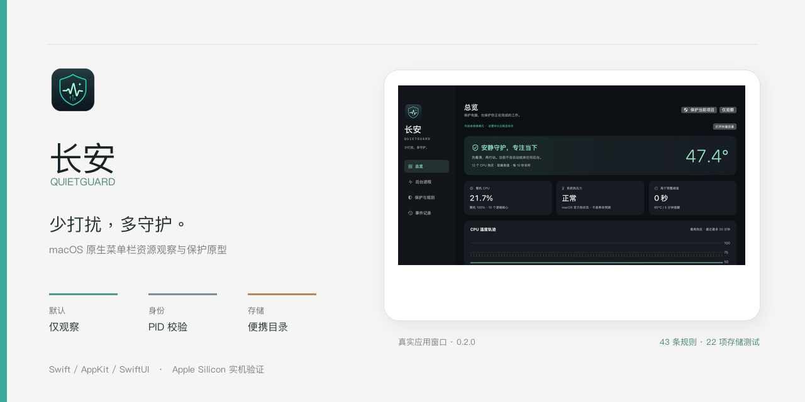
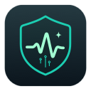
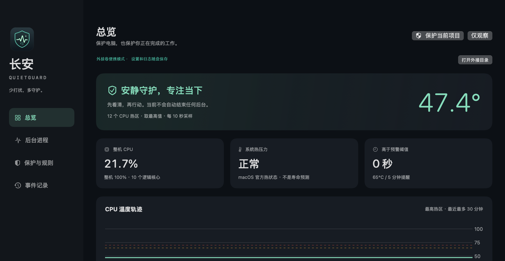
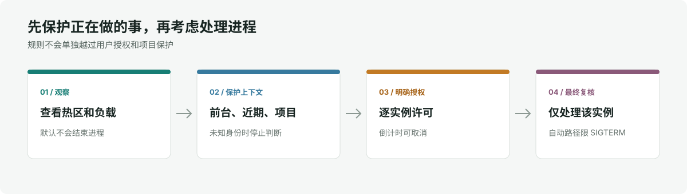

# 长安 QuietGuard

少打扰，多守护。一个面向 macOS 的原生菜单栏资源观察与进程保护原型，默认只观察，并把“何时可以处理”限制在可检查、可取消的规则里。

  

  macOS 15 · Apple Silicon 实机验证 · Swift / AppKit / SwiftUI

截图来自 0.2.0 版本的真实应用窗口，裁切掉了窗口外桌面和进程列表。温度、CPU 与状态值是当时的本机采样，不代表当前设备或通用基准。

## 项目定位

长安不是 AI 应用，目前没有接入大模型。它尝试把温度和后台负载观察、重要项目保护、进程身份校验与本地处置规则整合到一个小型 macOS 工具中。界面文案不会把“降低调度优先级”说成 CPU 硬限速，也不会把温度阈值说成硬件损伤线。

## 保护设计

- 默认仅观察；项目保护开关会暂停全部自动处理。
- 高温、持续高 CPU、低磁盘活动、后台时长、实例授权、通知、外接数据卷和保护规则需要同时满足，才可能进入自动处置倒计时。
- 授权绑定 PID、启动时间和可执行路径；执行前重新读取身份与保护状态。
- 自动处理只发送 SIGTERM，不会因目标未退出而升级到 SIGKILL。手动强制结束则需要单独确认。
- 配置和事件存放在应用同级 Data；便携目录失效时不会悄悄切到用户目录。

默认规则是个人管理偏好，不是硬件安全标准。高 CPU 或低磁盘活动不能证明某个任务已经空闲；编译、渲染、推理和同步都可能长时间占用资源。关键任务仍应由用户主动保护。

## 当前验证范围

0.2.0 在 Apple M4 / macOS 15.8 环境完成原生构建与便携路径验证：43 项规则/保护测试、22 项存储测试通过；信号集成测试只对测试中新建的 sleep 子进程运行。没有拿已有后台进程做结束测试。

尚未完成无人值守长测、完整通知/休眠/锁屏组合、多机型验证、实体拔盘测试和独立安全审计。AppleSMC 温度映射属于实验性只读实现，系统更新可能令其不可用；本机 ad-hoc 签名不等于 Developer ID 公证。

## 源码与构建

源码快照包含外接卷便携存储实现；应用需要配有项目标记的外接卷，并会校验卷身份后再读写数据。当前构建流程仍依赖预先准备好的便携目录，尚未整理成从任意 GitHub 克隆即可直接运行的通用安装流程。公开快照不包含作者本机的迁移、验收和发布脚本。

在已准备好便携目录和对应卷标记的 macOS 环境中，退出运行中的长安后执行：

~~~sh
python3 tools/build.py --test --probe --skip-icons
~~~

应用、测试报告与缓存写入便携目录的 Work；该脚本不会上传文件或创建 GitHub Release。

## 项目来源与许可

项目由 Leo 发起并持续维护，开发过程中使用 AI 编程工具协助实现与测试。当前实现复用了 Stats v3.0.17 的 AppleSMC 读取相关代码，并保留 MIT 许可与来源记录，详见 THIRD_PARTY.md 和 Vendor/Stats/LICENSE。其余许可信息见 LICENSE。

## 安全说明

本项目是受控原型，不是杀毒软件、硬件诊断认证或无人值守的安全系统。任何结束进程的操作都有数据丢失风险；自动识别应用用途也不完备。使用前请阅读 SECURITY.md。
